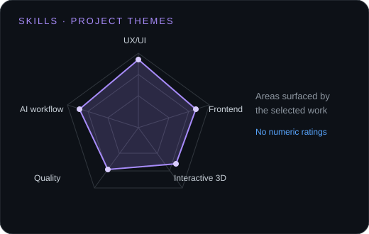
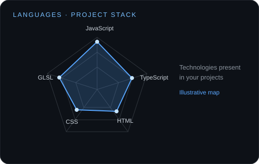

# Francesco Pierfederici

### Web Designer & AI Builder · UX/UI · Frontend · ex Mobile QA at Samsung

I design and build thoughtful, interactive websites with AI-native workflows. My work brings together UX/UI, frontend development, and a quality-first approach shaped by two years in mobile QA at Samsung.

[Portfolio](https://francescopierf.com) · [LinkedIn](https://www.linkedin.com/in/francescopierfederici/)

<picture>
  <source media="(prefers-reduced-motion: reduce)" srcset="./assets/profile-banner.svg">
  
</picture>

## This is me

- Based in Senigallia, Italy; working across UX/UI, web design, and frontend.
- Previously mobile QA at Samsung, working on Bixby, SmartThings, and Camera AI.
- Now building web experiences with tools including Lovable and Claude Code.

## Selected work

| Project | What it shows |
| --- | --- |
| [LUCE](https://francescopierfederici.github.io/luce-3d-landing/) | Scroll-driven 3D product experience · Three.js |
| [Avanzi](https://francescopierfederici.github.io/avanzi-cantiere/) | Marketplace concept · React · TypeScript · MapLibre |
| [Lorenzo Livieri](https://lorenzolivieri.vercel.app/) | Production author website · mobile-first design |
| [Meridian](https://francescopierfederici.github.io/meridian-case-study/) | Frontend and design case study |

## Signals

  
  

These diagrams group areas and technologies shown in my projects; they are not proficiency scores.

## Toolkit

**Design** · Figma · UX/UI  
**Frontend** · HTML · CSS · JavaScript · React · TypeScript · Three.js · MapLibre · Bootstrap  
**Workflow** · Git · Vercel · Lovable · Claude Code

## Numbers matter?

Based in Senigallia, Italy · Open to remote and freelance collaborations  
[Website](https://francescopierf.com) · [LinkedIn](https://www.linkedin.com/in/francescopierfederici/)

